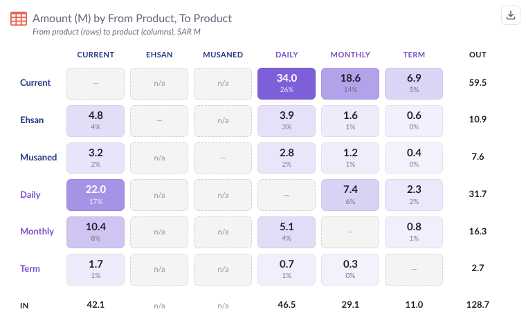

# Matrix Table — Tableau Viz Extension

A matrix (crosstab) with tiles: dimensions on rows and columns with several levels each, one main value per cell with
smaller, faded values under it (other measures, % of total, difference, % difference, running total, rank), heat-map
shading, group totals that fold, a diagonal mark for From → To matrices, and export to Excel (as shown or data only)
and CSV. The icon, title and explanation are the same as **KPI Card**; the card options, number formatting and presets
are the same as **Bar Chart**.



```
matrix-table.trex  manifest: Marks card tiles + "Format Extension" button
index.html         matrix page
chart.css/js       header, data reading, matrix model and calculations, table, tooltip, right-click menu, export
export.js          CSV and a small XLSX writer (no libraries): fills, fonts, borders, number formats, merged headers
configure.*        Format dialog (every option below)
config.js          shared defaults, number and date formatting, Excel number formats
icons.js, icons/extension/ the 14 Figma icons from *Icons for Extension* (same files as KPI Card)
fonts/             Lato 2.0 (OFL), WOFF2 Latin subset
presets/           example preset (Transfer matrix = the base design)
serve.py/.sh       local server on :8770, also lists Tableau shape palettes
dev/               browser preview with sample data (no Tableau needed)
```

`Development Resources/` stays out of git.

## Run it

```bash
chmod +x serve.sh && ./serve.sh
```

In Tableau Desktop (2024.2+): Marks card → mark type dropdown → **Add Extension** → **Access Local Extensions** →
`matrix-table localhost.trex` (in the `tableau-extensions` folder; it points at `http://localhost:8770`).

To try it without Tableau, open <http://localhost:8770/dev/preview.html>. It has ten sample data sets (From → To
products, Region › Segment by Year with a Color measure, two levels on both axes, months by year, negatives, raw large
numbers, rows only with three measures, averages and distinct counts, no dimensions, a wide one for scrolling) and opens
the Format dialog next to the matrix. To get the base design, import `presets/Transfer-Matrix.json` in Format →
Presets.

| Marks card tile | What to drop | Drives |
| --- | --- | --- |
| **Rows** | 0–6 dimensions, outermost first (e.g. Category, Sub-Category) | the row headers. Outer fields group the inner ones; they can have group totals and fold |
| **Columns** | 0–6 dimensions, outermost first (e.g. Year, Quarter) | the column headers |
| **Measure** | one or more measures, dropped **one at a time** | the cell values. The first is the main value (Layout → *Main measure*); the others sit under it, smaller, or get their own columns or rows |
| **Color** | one measure (optional) | the cell shading (Colors → *Shade by* Automatic) |
| **Tooltip** (Tableau's) | measures (optional) | extra rows in the tooltip |

- **Measures** (Layout tab): *In the cell* (main value big, the rest small), *As columns* or *As rows* (like Measure
  Names on Columns / Rows), innermost or outermost.
- **Calculations** (Calculations tab): % of total, difference, % difference (from the previous or first cell), running
  total and rank. **Compute using** sets the direction for all of them, like Tableau's table calculations: *Table*,
  *Table across* (each row), *Table down* (each column), *Pane across* and *Pane down* (within the outer group). Each
  calculation can override it. The right-click menu switches % of total between table, row and column directly.
- Every part of a cell can be shown or hidden: main value, other measures (with or without names), each calculation.
  Their order and placement (under or beside the main value) are on the Calculations tab; their size, colour and fading
  on the Cells tab.
- **Totals** (Totals tab): a total row and a total column (labels editable, e.g. IN / OUT), and group totals per
  outer field. Click ▾ next to an outer header to fold the group into its totals; ▸ unfolds it.
- **How totals add up** (Measures tab): automatic from the aggregation (SUM / COUNT add up, AVG averages, MIN / MAX,
  distinct counts and AGG() stay empty), or set per measure. The extension computes totals from the cells it gets, so
  ratios need *Average* or *Leave empty*. % of total is only shown for measures that add up.
- **Diagonal**: a cell whose row and column are the same member shows a mark (default —). **Same members both ways**
  lists the same members on both axes for From → To matrices; missing pairs show *n/a*.
- **Headers** (Headers tab): orientation (horizontal, vertical up, vertical down), alignment across and up/down, font,
  capitals and letter spacing, separately for the innermost and the outer levels of rows and columns; merged or
  repeated outer members, top-left corner text, and a colour per member (e.g. one colour per product family).
- **Shading** (Colors tab): heat map, − / + (diverging) or data bars, by the value, % of total, the Color tile or any
  measure, across the whole table, each row or each column. Rules colour cells that meet a condition.
- **Sort** (Sort tab): members as in the data, by name or by total, at every level; click a column header to sort the
  rows by it (high to low, low to high, off).
- Hover highlights the row and column; headers stay in view while scrolling (Layout → *Freeze headers*).
- **Swap rows and columns** (Layout tab or right-click) without moving pills.
- If Tableau delivers the measures as *Measure Names / Measure Values*, the extension pivots them back.

## Export

The button at the top right (on hover, always or never — Export tab) and the right-click menu offer:

| Export | What you get |
| --- | --- |
| **Excel — as shown** | the matrix as drawn: merged headers, colours, fonts, borders, number formats, rotated headers, frozen headers, title on top. Cells with smaller values keep both sizes of text in one cell (they are text then); Export → *Smaller values: Leave out* keeps every cell a number |
| **Excel — data only** | one row per cell: Rows fields, Columns fields, every measure and the shown calculations of the main measure; filter and frozen header row |
| **CSV — data** | the same as a CSV (UTF-8) |
| **CSV — crosstab** | the matrix as shown, one CSV cell per matrix cell |
| **Copy table** | the matrix as a table on the clipboard; paste into Excel, Sheets or an email with colours |

Tableau Desktop can block downloads from extensions. Then use **Copy table**. Tableau Server and Cloud in a browser
download normally.

## Format dialog

| Tab | What it sets |
| --- | --- |
| Icon | built-in icons, Tableau shapes (via `serve.py`) or an uploaded image; size and colour |
| Title & text | title, explanation, fonts, alignment |
| Layout | measures in the cell / as columns / as rows, main measure, swap, same members both ways, column width (fit, by content, fixed), row height, gaps, freeze headers, banded rows, hide empty rows / columns, diagonal, texts for no data and zero |
| Measures | display name, how totals add up, own number format, per measure |
| Calculations | compute using, main value, other measures, % of total, difference, % difference, running total, rank, their order and placement |
| Cells | tile colour, radius, padding, border, alignment, main value font, smaller values (size, weight, colour, opacity), empty cells, number format |
| Colors | heat map, − / +, data bars, shade by, range, rules |
| Headers | orientation, alignment, fonts per level, merge, wrap, background, lines between groups, corner, colour per member |
| Totals | total row and column (position, label), group totals, fold, total cell look, labels, number format |
| Sort | member order for rows and columns, rows by a column |
| Tooltip & actions | tooltip contents, row / column highlight, header sort, right-click menu, double-click, select in Tableau, Format window always on top or floating |
| Export | export button, file name, title in Excel, smaller values in Excel, calculations and totals in data exports |
| Numbers | one format for everything or each part its own, font |
| Card | padding, space above the matrix, card and matrix backgrounds |
| Presets | export / import the settings as a file, by copy-paste, or in *My presets* |

## Settings and deploying

All settings are saved in the workbook under one key (`matrixTable1`). The extension is served from GitHub Pages
(`Cobani/matrix_table_extension`) at `https://cobani.github.io/matrix_table_extension/` (`matrix-table.trex`). Before every commit run
`python3 stamp-versions.py` so browsers never mix old and new files. After a `.trex` change, remove and re-add the
extension in the workbook.

## Fast reload

The last drawn data is kept in the browser (`matrixtable:lastRender:v1:…`, 30 days, up to 400k characters) and drawn
straight after the Tableau handshake, then replaced by the live data. It is dropped when the fields on the Marks card
change.

## Load timings (debug)

Add `?debug` to the preview URL (or the `.trex` URL) to log the load steps to the console.
